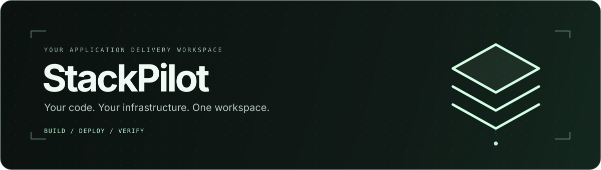
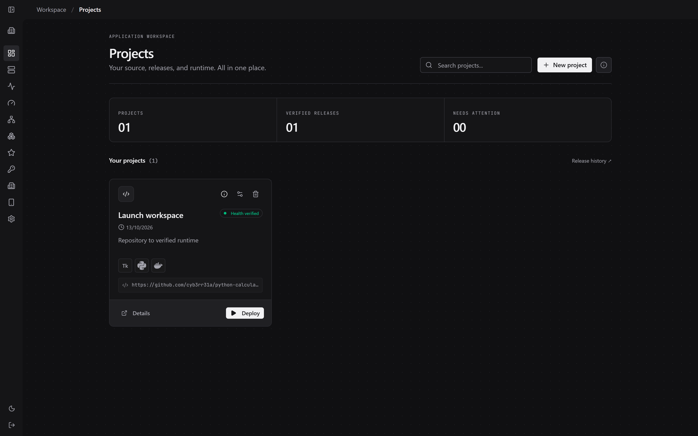
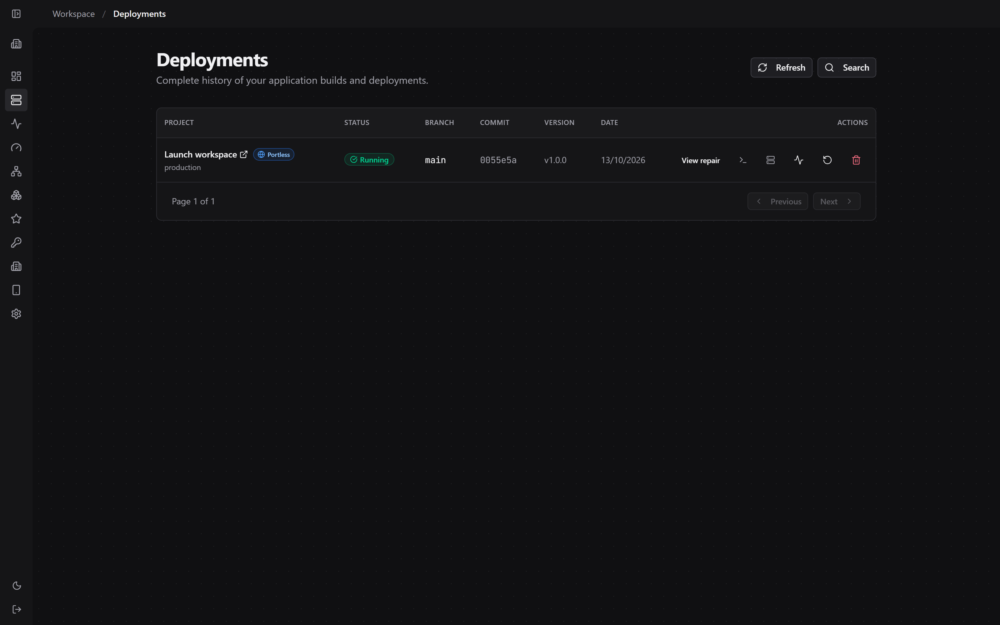
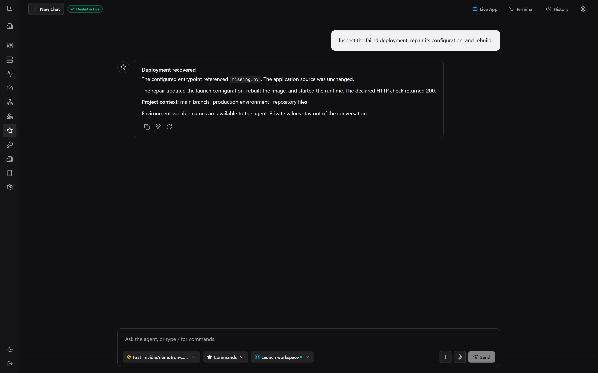
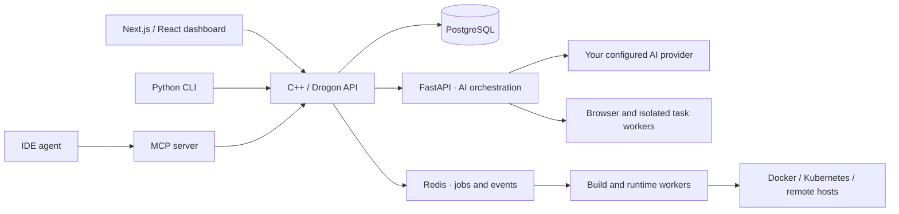

# StackPilot

<p align="center">
  
</p>

<p align="center">
  <strong>A full-stack agentic AI deployment platform you run on your own infrastructure.</strong><br>
  Import a repository. Build and deploy it. Investigate failures. Verify what actually works.
</p>

<p align="center">
  <a href="https://github.com/AdityaRoy999/StackPilot/actions/workflows/ci.yml"></a>
  <a href="#quick-start"></a>
  <a href="docs/ai-agent.md"></a>
  <a href="mcp-server/README.md"></a>
</p>

<p align="center">
  <a href="#quick-start">Get started</a> ·
  <a href="#what-you-can-do">Features</a> ·
  <a href="#see-the-workspace">Screenshots</a> ·
  <a href="docs/README.md">Documentation</a> ·
  <a href="CONTRIBUTING.md">Contribute</a>
</p>

StackPilot brings source code, deployments, runtime health and AI-assisted recovery into one workspace. Its Next.js dashboard connects to a C++/Drogon control plane, PostgreSQL, Redis and a FastAPI agent service. Use the dashboard, an authenticated Python CLI, or an MCP-connected IDE agent to work with the same platform.

**Your deployment environment stays under your control.** Run locally, connect a remote Docker host, or target Kubernetes. AI is optional; when enabled, requests go to the provider you configure. Project secrets stay in the execution layer, while recovery context exposes variable names and scopes to the agent.

## Quick start

Install **Git**, **Docker with Compose v2**, and **Python 3.10+ with venv support**. Start Docker before continuing. Docker Desktop works on Windows and macOS; Linux can use Docker Engine. A GPU is optional.

### Windows · PowerShell

```powershell
git clone https://github.com/AdityaRoy999/StackPilot.git
Set-Location StackPilot
./scripts/install.ps1 -Profile core
```

### macOS / Linux

```bash
git clone https://github.com/AdityaRoy999/StackPilot.git
cd StackPilot
bash scripts/install.sh --profile core
```

Open **[localhost:3000](http://localhost:3000)**, create an account, and follow the **Setup guide** to connect and test your AI provider—or skip AI and start with deployment management.

The installer creates a private CLI environment, generates essential secrets locally, and builds the selected services. It preserves an existing `.env`. The first build can take several minutes, depending on your machine, network and image cache.

Prefer a local setup wizard? See [guided installation](docs/guided-setup.md) for the Windows, macOS and Linux launchers. For a public server, start with [production self-hosting](docs/production-self-host.md).

<details>
<summary><strong>Choose a lighter installation or configure Docker manually</strong></summary>

| Installer profile | Included services |
| --- | --- |
| `base` | Dashboard, backend, PostgreSQL, Redis and runtime gateway |
| `core` | Base services + AI service and local browser sandbox |
| `full` | Core services + search |
| `monitoring` | Full platform + metrics, logs and Grafana |

For manual configuration:

```bash
python scripts/configure.py
docker compose --profile ai --profile browser up -d --build
```

Installer profiles and Compose profiles are different: the installer translates `core` into the `ai` and `browser` Compose profiles. See [configuration](docs/configuration.md) for advanced settings and [guided setup](docs/guided-setup.md#existing-projects-anywhere-on-your-computer) for local drive access.

</details>

## What you can do

| Capability | In the workspace |
| --- | --- |
| **Bring your source** | Import a GitHub repository, browse existing local project folders, connect an SSH source, or send a staged artifact from your IDE. |
| **Build and deploy** | Use a repository Dockerfile, supported generated build plan, Compose stack, or explicit build recipe. Deliver locally or to configured remote Docker/Kubernetes targets. |
| **Keep environments distinct** | Map branches to environments, scope variables and credentials, and preserve existing hosted backend/database connections. |
| **Follow every release** | Stream build logs and inspect deployment history, runtime URLs, container health and recorded verification evidence. |
| **Investigate and repair** | Give the AI agent project, branch, environment and failure context. Inspect files, make scoped repairs, run checks and rebuild through the recovery workflow. |
| **Test in a real browser** | Ask the browser agent to interact with pages, fill forms, select native options and verify outcomes, with a live viewer and protection against duplicate actions. |
| **Work across your infrastructure** | Manage clusters and saved remote connections, open configured RDP desktops, and pair another device for remote dashboard access. |
| **Use your own tools** | Work through the authenticated Python CLI or expose backend operations to IDE agents through the MCP server. |

AI workflows retain permission, scope and verification boundaries. A running container or a successful click alone does not establish that the requested application workflow passed.

## See the workspace

<p align="center">
  
  <br><sub>Project workspace · source, detected stack and runtime status. Demo project shown.</sub>
</p>

<details>
<summary><strong>Deployment history and AI-assisted recovery</strong></summary>

### Follow releases



Inspect the branch, commit, release status and runtime actions without leaving the dashboard. Demo release shown.

### Investigate failures



The recovery interface brings project context and recorded results together. This illustrative demo shows an entrypoint repair; actual outcomes depend on the repository, provider and verification results.

</details>

## From repository to verified runtime

1. **Connect a project.** Choose a source and review the detected stack. Local projects can stay in their existing folders on the StackPilot host.
2. **Configure an environment.** Select the branch, deployment target, variables and service connections. Existing hosted databases and APIs can remain part of the deployment.
3. **Build and inspect.** Follow live logs as StackPilot builds the pinned source revision and records the attempt.
4. **Verify and release.** Check runtime health and any configured tests or acceptance workflows. Inspect the evidence when a check fails.
5. **Recover with context.** Use the AI workflow to investigate a failed attempt, repair source or configuration, test it and rebuild. Recovery does not guarantee that every failure can be resolved automatically.

For deeper verification, declare tests, health checks and workflows in [`stackpilot.json`](deployment-runtime/README.md). Repository tests and runtime health checks establish different kinds of evidence; configure both where they matter.

## Application and runtime support

StackPilot supports multiple delivery types. The required toolchain and worker depend on the application.

| Application type | Delivery path and requirements |
| --- | --- |
| **Web apps and APIs** | Container builds, HTTP readiness/content checks, preview routing and configured browser workflows. |
| **Multi-service applications** | Local Compose with resolved configuration validation and service readiness checks; Kubernetes plans support their documented semantics. |
| **Workers, jobs and TCP services** | Process, exit/output or connection checks appropriate to the workload. |
| **CLI applications and packages** | Configured interactive console workflows or downloadable artifacts with checksums/manifests. |
| **Linux desktop applications** | Compatible X11 applications through the configured desktop/noVNC adapter and explicit build recipes. |
| **Android applications** | Gradle/APK builds; install, launch and declared native checks require the configured Android emulator worker. |
| **Windows, macOS and iOS** | Platform-specific constraints apply. A Windows EXE build/download path is qualified for a sample; general native Windows execution and macOS/iOS workers remain unfinished. |

See [deployment contracts](deployment-runtime/README.md), [Android worker setup](native-worker/README.md), [Windows connections](docs/windows-connection-setup.md) and the [completion plan](docs/stackpilot-completion-plan.md) for exact boundaries. StackPilot does not guarantee deployment or autonomous completion of every repository.

## How it fits together



PostgreSQL persists projects, environments, deployment history and recovery state. Redis coordinates jobs and events. The backend owns deployment operations; the AI service supplies planning and browser tools. Browser, runtime and native workers have separate configuration and trust boundaries.

Read the [architecture guide](docs/architecture.md) for source types, runtime strategy and cleanup behavior.

## CLI and IDE agents

Use an authenticated terminal workflow against the same backend:

```bash
stackpilot auth login
stackpilot test https://example.com --sandbox local
```

The installer places the CLI in `.stackpilot-venv`. If `stackpilot` is not on your path, use `.stackpilot-venv/Scripts/stackpilot.exe` on Windows or `.stackpilot-venv/bin/stackpilot` on macOS/Linux.

The MCP server lets IDE agents stage the current project, submit it to StackPilot, and inspect deployment results through scoped backend access. See the [CLI guide](stackpilot-cli/README.md) and [MCP integration guide](docs/mcp-ide-agents.md) for installation, authentication and tool configuration.

## Verification you can inspect

The [CI workflow](.github/workflows/ci.yml) covers C++ units, AI regressions, dashboard lint/tests/build, website and CLI contracts, deployment contracts, Compose validation and full-stack integration.

The [17 October 2026 browser qualification](docs/browser-agent-reliability-2026-10-17.md) recorded **406 passing browser regression tests** with **138 skipped**, plus verified workflows across **six public website domains** after fixes and targeted retests. Those website results combine multiple runs, not one clean six-site run on a single final revision. They do not establish universal browser-agent reliability or a performance guarantee.

External-provider tests, native hardware and remote-worker qualification require their own configuration. See the [test guide](tests/README.md) for commands and scope, or the [CPU decision-model guide](docs/browser-decision-model-training.md) for the optional local-policy direction.

## Documentation

| You want to… | Start here |
| --- | --- |
| Install and configure StackPilot | [Quickstart](docs/quickstart.md) · [Guided setup](docs/guided-setup.md) · [Configuration](docs/configuration.md) |
| Import, configure and deploy a project | [Project setup](docs/project-setup.md) · [Deployment workflows](docs/deployment-workflows.md) · [Environments and CI](docs/environments-ci.md) |
| Understand the AI and browser workflows | [AI agent](docs/ai-agent.md) · [Browser synchronization](docs/browser-page-synchronization.md) · [Browser decisions](docs/browser-decisions.md) |
| Connect infrastructure and devices | [Cluster management](docs/production-cluster-management.md) · [Windows VM](docs/windows-connection-setup.md) · [RDP desktops](docs/rdp-connections.md) |
| Run and maintain a server | [Production self-hosting](docs/production-self-host.md) · [Operations](docs/operations.md) · [Security](docs/security.md) |
| Investigate a problem | [Troubleshooting](docs/troubleshooting.md) · [Current support boundaries](docs/stackpilot-completion-plan.md) |

Browse the complete [documentation index](docs/README.md).

## Development and contributing

Contributions are welcome. Start with [CONTRIBUTING.md](CONTRIBUTING.md) for local setup, checks and migration conventions. Report reproducible bugs or request features through [GitHub Issues](https://github.com/AdityaRoy999/StackPilot/issues).

<details>
<summary><strong>Repository map</strong></summary>

| Directory | Responsibility |
| --- | --- |
| `frontend/` | Next.js / React application dashboard |
| `src/`, `sql/` | C++ / Drogon API, build orchestration and database migrations |
| `ai-service/` | FastAPI agent orchestration, browser testing and scoped task execution |
| `deployment-runtime/` | Build recipes, workload adapters and verification contracts |
| `browser-sandbox/`, `native-browser/`, `native-worker/` | Browser capture and configured host/native workers |
| `runtime-gateway/`, `remote-gateway/` | Runtime preview routing and paired remote access |
| `stackpilot-cli/`, `mcp-server/` | Authenticated terminal and IDE integrations |
| `stackpilot web/` | Public website and installation entry points |
| `observability/` | Metrics, logs and dashboards |
| `scripts/`, `tests/`, `.github/` | Installers, regression suites and CI |
| `docs/` | Architecture, configuration and operational guides |

</details>

## Security and self-hosting

StackPilot manages code execution, credentials and infrastructure. Keep `.env`, runtime data and provider keys out of Git. Do not expose Docker sockets, browser debugging ports or internal service tokens publicly. Public server deployments need HTTPS and appropriate worker isolation, quotas and network policy.

Review the [security guide](docs/security.md) and [production self-hosting guide](docs/production-self-host.md) before connecting other users or exposing the platform beyond your machine.
